## Part 1
**Вывод информации об ОС**

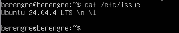

## Part 2
* Создание пользователя

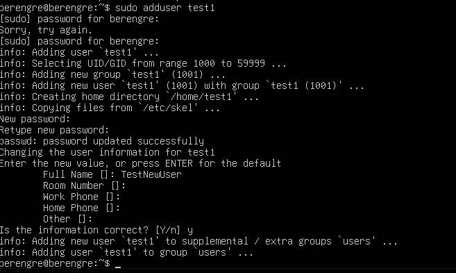

* Добавление пользователя `test1` в группу `adm`.

* Вывод

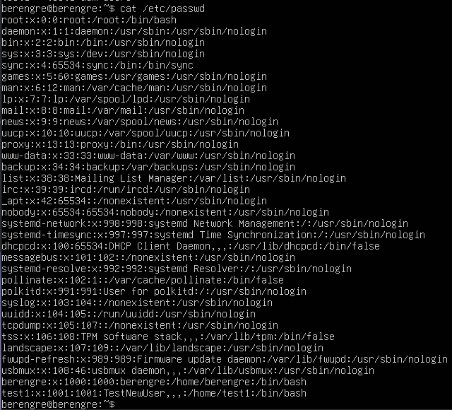

## Part 3

<h3>1.</h3>

* Смена хоста командой `sudo hostnamectl set-hostname user-1`

<h3>2.</h3>

* Установка временной зоны `sudo timedatectl set-timezone Europe/Moscow`

<h3>3.</h3>

* Вывод сетевых интерфейсов `ip a`

* Интерфейс `lo(localhost)` - локальное соединение для общение служб и программ между собой без интернета.

<h3>4.</h3>

* Выведен ip адрес полученный от DHCP командой `networkctl status enp0s3` - 10.0.2.15 DHCP4
* DHCP - автоматическая раздача сетевого адресса чтобы получить доступ выхода в интернет без ручной настройки

<h3>5.</h3>

* Командой `ip r` выводим наш gw (Gateway - шлюз по умолчанию) `default via 10.0.2.2 dev enp0s3`

<h3>6.</h3>

* Задал статические настройки использовал команду `sudo nano /etc/netplan/50-cloud-init.yaml`

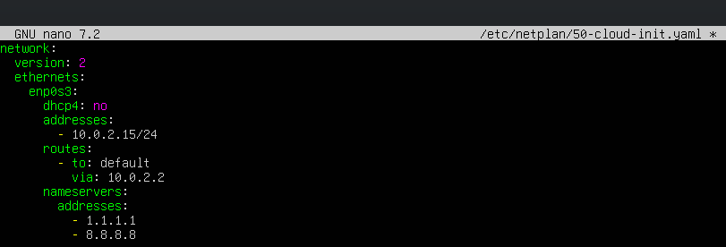

<h3>7.</h3>

* Перезагрузка вм и пинг хостов 1.1.1.1 && ya.ru

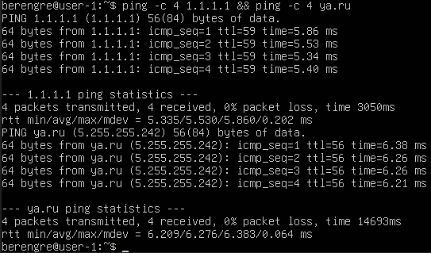

## Part 4

* Установка пакетов командой `sudo apt upgеrade && sudo apt upgrade -y`

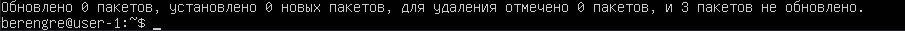

## Part 5

* Sudo - `super_user` позволяет временно выполнять административную команду с повышенным уровнем доступа **root** (Все команды выполненые через sudo фиксируются в системном журнале)

* Добавил созданного ранее пользователя `test1` в группу `sudo` с помощью команды **`sudo usermod -aG sudo test1`** чтобы разрешить ему выполнение административных команд

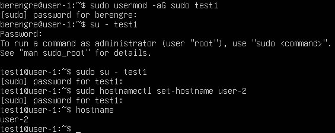

## Part 6 

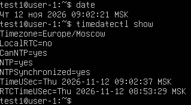

## Part 7

<h2>Первый блок<h2>

* Установил нужные редакторы командой **`sudo apt update && sudo apt install -y nano vim mcedit`**

<h3>vim</h3>

* `vim test_vim.txt` открытие затем нажатие **`i`** написал логин

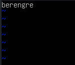

* После ввода логина нажал **`ESC`** и вписал **`:wq`** - write quit

<h3>nano</h3>

* `nano test_nano.txt` открыл ввел логин

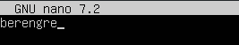

* После ввода логина нажал **`CTRL + o`** затем **`ENTER`** и для выхода **`CTRL + X`**

<h3>mcedit</h3>

* `mcedit test_mcedit.txt` открыл ввел логин

* Для сохранения и выхода нажал **`F10`** затем выбрал в меню **`да`** что бы сохранить
---
<h2>Второй блок<h2>

<h3>vim</h3>

* `vim test_vim.txt` открытие затем нажатие **`i`** написал `21 School 21`

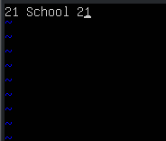

* После ввода логина нажал **`ESC`** и вписал **`q!`** - q-выход | !-принудительно что бы не видеть предупреждений

<h3>nano</h3>

* `nano test_nano.txt` открыл ввел логин 21 School 21

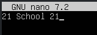

* После ввода логина нажал **`CTRL + x`** затем **`N`** для отказа от сохранения.

<h3>mcedit</h3>

* `mcedit test_mcedit.txt` открыл ввел логин 21 School 21

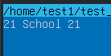

* Для выхода нажал **`F10`** затем выбрал в меню **`нет`** отказ от сохранения

---

<h2>Третий блок<h2>

<h3>vim</h3>

* `vim test_vim.txt` открытие затем нажатие **`i`** написал `21 School 21`

* Сделал поиск по слову

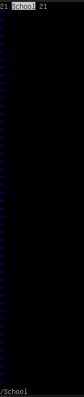

* Заменил слово командой **`:%s/School/Campus/g`** % - поиск по всем строкам s - замена /что хотим заменить/на что меняем g- глобальный параметр заменить все найденные результаты

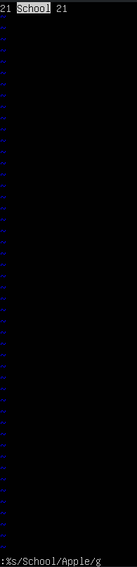

* После замены нажал **`ENTER`** и вписал **`wq`** 

<h3>nano</h3>

* Открыл файл командой `nano test_nano.txt` и заменил никнейм на строку `21 School 21`.
* Выполнил поиск слова с помощью комбинации **`Ctrl + W`**, ввёл `School` и нажал **`Enter`**:

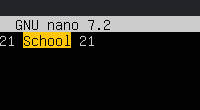

* Запустил замену слова комбинацией **`Ctrl + \`**, ввёл искомое слово `School` и слово для замены `Apple`:

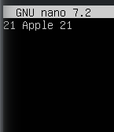

* Подтвердил замену клавишами **`Enter`** и **`Y`**, после чего вышел с сохранением (**`Ctrl + X`** -> **`Y`** -> **`Enter`**).

<h3>mcedit</h3>

* Открыл файл командой `mcedit test_mcedit.txt` и заменил никнейм на строку `21 School 21`.

* Выполнил поиск слова нажатием клавиши **`F7`**, ввёл `School` и нажал **`Enter`**:

 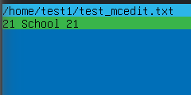
 
* Вызвал окно замены клавишей **`F4`**, указал искомое слово `School` и слово для замены `Apple`:
 
* Подтвердил замену нажатием **`Enter`**, после чего вышел с сохранением через **`F10`** -> **`Да`**.
    
## Part 8

* **Установка службы и настройка автозапуска:**
  * Установил пакет OpenSSH-сервера командой `sudo apt install -y openssh-server`.
  * Добавил службу в автозагрузку при старте системы с помощью команды `sudo systemctl enable ssh`.

* **Перенастройка SSHd на порт 2022:**
  * Открыл конфигурационный файл `sudo nano /etc/ssh/sshd_config`, раскомментировал строку `Port 22` и изменил значение порта на `Port 2022`.
  * Отключил активацию через сокет (`sudo systemctl disable --now ssh.socket`) и активировал службу напрямую (`sudo systemctl enable --now ssh.service`), чтобы настройки порта применялись сразу при запуске системы.

* **Проверка наличия процесса `sshd` с помощью команды `ps`:**
  * Выполнил команду `ps -ef | grep sshd` для поиска запущенного процесса службы в списке процессов системы:
  
     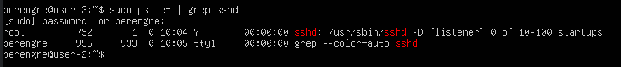
     
  * **Значение команды и ключей:**
    * `ps` (*Process Status*) — утилита для вывода информации о текущих запущенных процессах в системе.
    * `-e` (*everyone*) — отобразить все процессы, запущенные в системе, независимо от пользователя и терминала.
    * `-f` (*full-format*) — вывести расширенный формат таблицы (владелец процесса `UID`, идентификатор `PID`, родительский процесс `PPID`, время запуска и полная команда).
    * `| grep sshd` — фильтрация вывода для отображения только тех строк, которые содержат имя процесса `sshd`.

* **Перезагрузка системы и проверка прослушиваемого порта (`netstat -tan`):**
  * Перезагрузил виртуальную машину командой `sudo reboot`.
  * Установил пакет сетевых утилит `sudo apt install -y net-tools` и выполнил команду `netstat -tan`, убедившись в наличии строки `tcp 0 0 0.0.0.0:2022 0.0.0.0:* LISTEN`:
  
     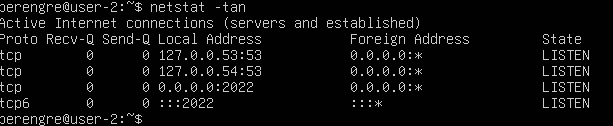
     
  * **Значение ключей `-tan`:**
    * `-t` (*TCP*) — показывать только соединения по протоколу TCP.
    * `-a` (*all*) — отображать все сокеты (как активные соединения, так и слушающие порты).
    * `-n` (*numeric*) — выводить IP-адреса и номера портов в числовом виде без преобразования в доменные имена и названия служб.
  * **Значение столбцов вывода:**
    * `Proto` — протокол передачи данных (`tcp` или `tcp6`).
    * `Recv-Q` — количество байт в очереди на приём, ещё не прочитанных приложением.
    * `Send-Q` — количество байт в очереди на отправку, ещё не подтверждённых удалённой стороной.
    * `Local Address` — локальный IP-адрес и порт на текущей машине (`0.0.0.0:2022`).
    * `Foreign Address` — удалённый IP-адрес и порт подключённого клиента (`0.0.0.0:*` означает ожидание подключения с любого адреса и любого порта).
    * `State` — текущее состояние сокета (`LISTEN` означает, что служба запущена, «слушает» порт и ждёт входящих подключений).
  * **Значение адреса `0.0.0.0`:**
    * Адрес `0.0.0.0` в столбце `Local Address` означает все доступные сетевые IPv4-интерфейсы данной машины. Служба SSHd готова принимать входящие соединения на порт `2022` через любой сетевой интерфейс сервера.

## Part 9

<h2>top</h2>

* Запуск службы `top`
* uptime - **`15 min`**
* количество авторизованных пользователей - **`1 user`**
* Загрузка системы - **`1m,5m,15m (0,06, 0,07, 0,08)`**
* общее количество процессов - **`Tasks:104 total`**
* загрузка cpu - **`100,0 id`** ну или **`0,0 us, 0,0 sy`**
* загрузка памяти - **`3915 total; 3260,8, 449 used`**
* pid процесса занимающего больше всего памяти - **`1298`** - **`command (fwupd) 1,1%MEM`**
* pid процесса, занимающего больше всего процессорного времени - **`139`** **`(time 0:03.27) - command kworker/0:3-events`**

---

<h2>htop</h2>

* Запуск службы `htop`

* Фильтрация по PID

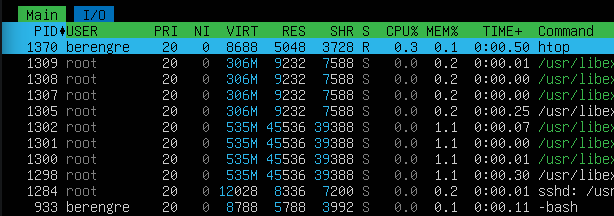

* Фильтрация по PERCENT_CPU

* Фильтрация по MEM

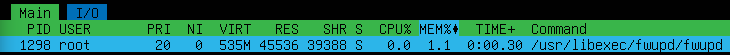

* Фильтрация по TIME

* Фильтрация для процессора `sshd`

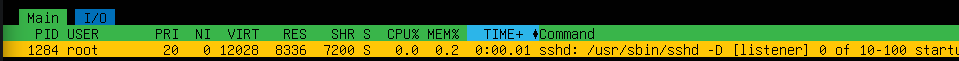

* syslog

* Добавленный вывод `hostname` `clock` `time`

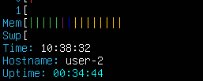

## Part 10

* Название жёсткого диска: `/dev/sda (модель VBOX HARDDISK).`
* Размер жёсткого диска: `40,96 GiB (43 980 455 936 байт).`
* Количество секторов: `85 899 328 секторов (по 512 байт каждый).`
* Размер swap: `0 B (раздел или файл подкачки в системе не создан, что подтверждается выводом команд sudo fdisk -l и free -h).`

## Part 11

* Запуск командой `df`
* размер раздела - `41 960 560 KB` 
* размер занятого пространства - `2 948 952 KB` 
* размер свободного пространства - `36 847 896 KB`
* процент использования - `8%`
* Единица измерения в выводе 1K-blocks - (1 килобайт = 1024 байта)

---

* Запуск командой `df -Th`
* размер раздела - `41G` 
* размер занятого пространства - `2,9G` 
* размер свободного пространства - `36G`
* процент использования - `8%`
* Тип файловой системы `ext4`

## Part 12

* использование команды `du` с параметром `-sb` `s-(общий итог)` `b-(вывод в байтах)`

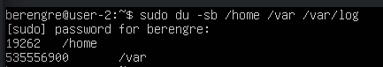

* использование команды `du` с параметром `-sh` `ключ -h (human-readable), в КБ, МБ, ГБ`

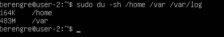

* Вывод размера каждого вложенного элемента в `/var/log (используя *)`

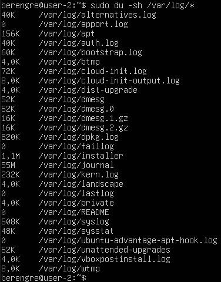

## Part 13

* Установка утилиты `ncdu`

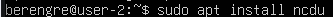

#### /home

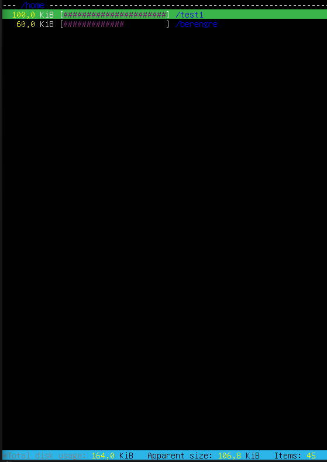

#### /var

#### /var/log

## Part 14

* Время последней успешной авторизации: 12 ноября 2026 года, 10:04:10 (2026-11-12T10:04:10).
* Имя пользователя: `berengre`.
* Метод входа в систему: `login` (локальный вход через консоль виртуальной машины).

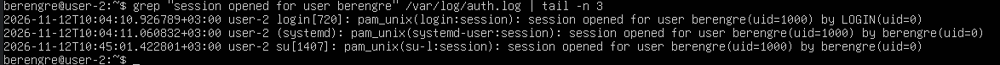
---

* Перезапуск службы ssh - `sudo systemctl restart ssh`

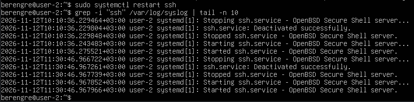

* Нахождение сообщения о рестарте в системном журнале - `grep -i "ssh" /var/log/syslog | tail -n 10`

## Part 15

* Вывод `crontab -l`

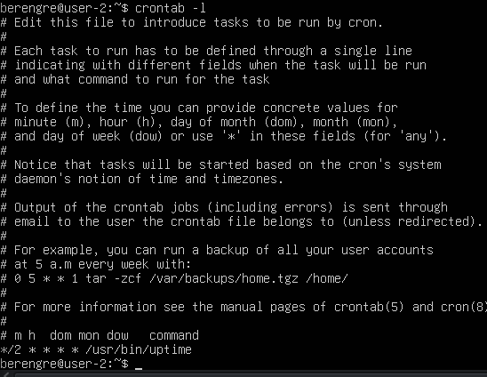

* Поиск записей в системном журнале команда `grep -i "CRON.*uptime" /var/log/syslog | tail -n 5`

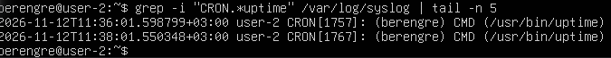

* Удаление всех заданий и проверка пустого списка

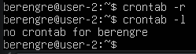
