## Part 1

* Установка `ipcalc` — инструмента для расчёта параметров IP-адресов: `sudo apt install ipcalc -y`

### 1.1 Сети и маски

#### (1)
* Определение адреса сети `192.167.38.54/13`

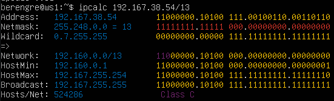

* Network: `192.160.0.0/13`

#### (2)
* Прогоняем подмаску сети, IP можно указать любой — в данном случае он выполняет роль пустышки.
* Команда `ipcalc 10.10.10.10/255.255.255.0`
* Команда `ipcalc 10.10.10.10/15`

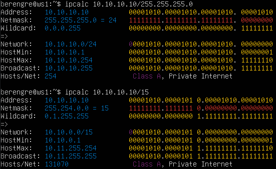

* Рассчитываем `11111111.11111111.11111111.11110000` = 8 + 8 + 8 + 4 = `/28`
* Прогоняем его через `ipcalc 10.10.10.10/28`

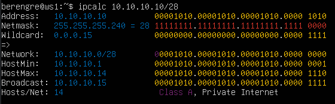

#### (3)
* Минимальный и максимальный хост в сети `12.167.38.4` при масках: `/8`

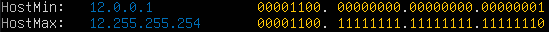

* Min и Max в `11111111.11111111.00000000.00000000`, 8 + 8 + 0 + 0 = `/16`

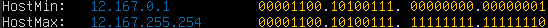

* Min и Max в `255.255.254.0` 

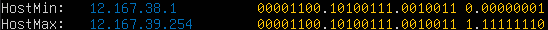

* Min и Max в `/4`

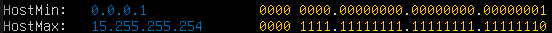

### 1.2 localhost

* Все `lo` присваиваются с `127.0.0.1` (сеть `127.0.0.0/8`)

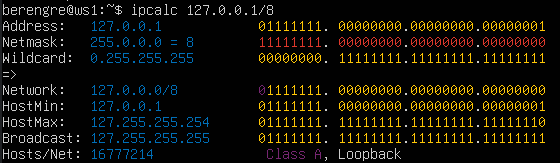

* `ping -c 2` для адресов `194.34.23.100`, `127.0.0.2`, `127.1.0.1`, `128.0.0.1`
* Доступны два локальных: **`127.0.0.2`** и **`127.1.0.1`**

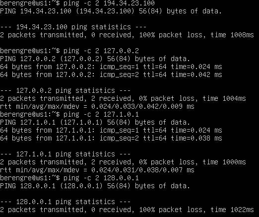

### 1.3 Диапазоны и сегменты сетей

#### (1)
* Смотрим на вывод `hosts/net`: если `Class` без других параметров — сеть публичная, если имеется `Private Internet` — сеть частная

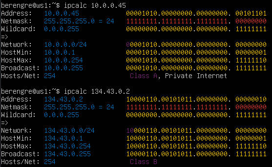

* **10.0.0.45** — частная сеть
* **134.43.0.2** — публичная
* **192.168.4.2** — частная
* **172.20.250.4** — частная
* **172.0.2.1** — публичная
* **192.172.0.1** — публичная
* **172.68.0.2** — публичная
* **172.16.255.255** — частная
* **10.10.10.10** — частная
* **192.169.168.1** — публичная

#### (2)
* Просматриваем диапазоны Min и Max у сети `10.10.0.0/18`

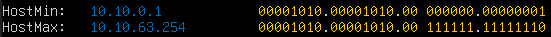

* Видим, что наш диапазон равен от `10.10.0.1` до `10.10.63.254`

* **10.0.0.1** — нет
* **10.10.0.2** — да (входит в диапазон)
* **10.10.10.10** — да (входит)
* **10.10.100.1** — нет (слишком велик)
* **10.10.1.255** — да (входит)

---

## Part 2

* Поднимаем две виртуальные машины (`ws1` и `ws2`) и смотрим их сетевые интерфейсы командой `ip a`

* Команда `ip a` для машин

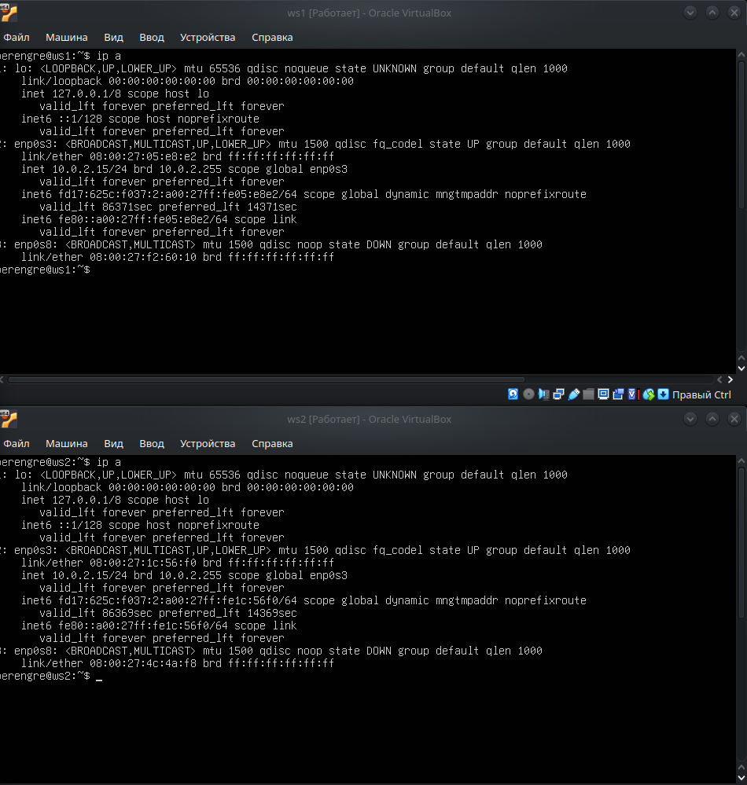

* Описываем сетевые интерфейсы командой `sudo nano /etc/netplan/00-installer-config.yaml` для **ws1**

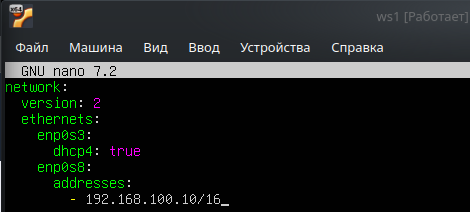

* Применяем настройки `sudo netplan apply`
 

* Описываем сетевые интерфейсы командой `sudo nano /etc/netplan/00-installer-config.yaml` для **ws2**

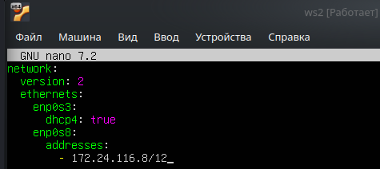

* Применяем настройки `sudo netplan apply`
 
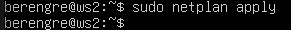

### 2.1 Добавление статического маршрута вручную

* Добавляем маршрут до сети второй машины и сразу проверяем связь: `ws1 -> ws2`
  `sudo ip route add 172.16.0.0/12 dev enp0s8`
  `ping -c 4 172.24.116.8`

* Добавляем маршрут до сети первой машины и сразу проверяем связь: `ws2 -> ws1`
  `sudo ip route add 192.168.0.0/16 dev enp0s8`
  `ping -c 4 192.168.100.10`

* Результат пинга:

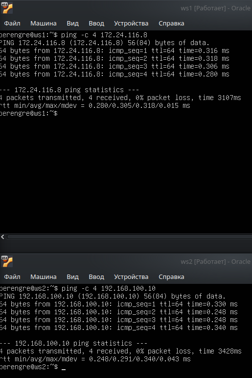

### 2.2 Добавление статического маршрута с сохранением

* Перезапускаем обе виртуальные машины (`sudo reboot`), после чего ручные маршруты из пункта 2.1 сбрасываются.
* Прописываем статические маршруты на постоянной основе в файле `/etc/netplan/00-installer-config.yaml` на **ws1** и **ws2** с помощью блока `routes` (`on-link: true`) и применяем настройки командой `sudo netplan apply`.

* Содержимое изменённого файла `/etc/netplan/00-installer-config.yaml` для **ws1** и **ws2**:

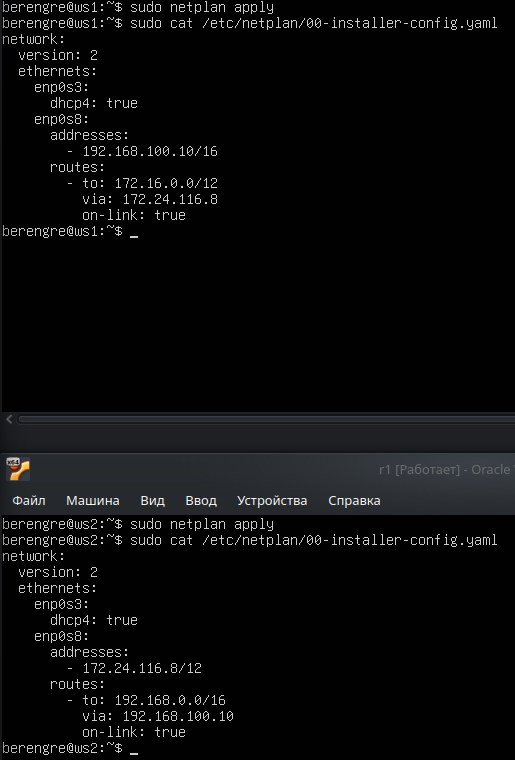

* Проверяем соединение между машинами после перезагрузки командой `ping -c 4`:

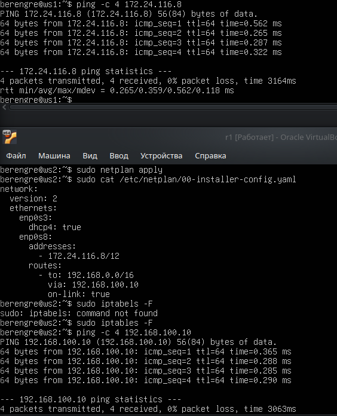

---

## Part 3 Утилита iperf3

### 3.1
* **8 Mbps в MB/s:** `1 MB/s` (делим 8 мегабит на 8, получаем 1 мегабайт).
* **100 MB/s в Kbps:** `800 000 Kbps` (переводим 100 мегабайт в мегабиты: 100 × 8 = 800 Mbps, затем умножаем на 1000).
* **1 Gbps в Mbps:** `1000 Mbps` (оба значения в битах, просто переводим гигабиты в мегабиты, умножив на 1000).

### 3.2 iperf3

* Осуществляем установку на две системы `ws1` и `ws2`:
  `sudo apt update && sudo apt install -y iperf3`

* На **ws1** открываем сервер командой `iperf3 -s`
* На **ws2** открываем клиент командой `iperf3 -c 192.168.100.10`

* Результат подключения:

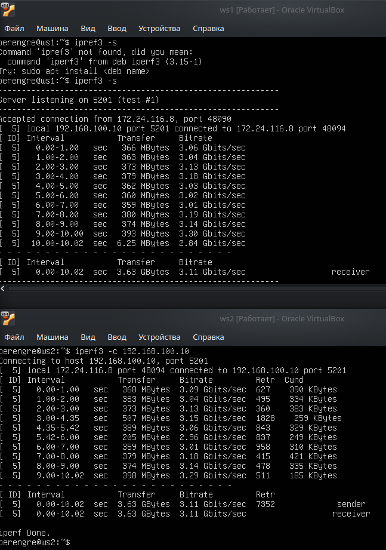

---

## Part 4 Сетевой экран

### 4.1 iptables

* Установка на две машины: `sudo apt update && sudo apt install -y iptables`
* Запуск и выдача прав на двух машинах:

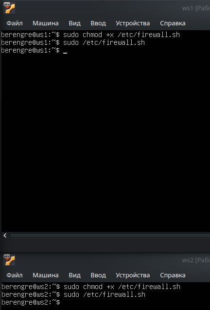

* Прописал для имитирующего firewall разрешение и дроп пинга.
* Результат:

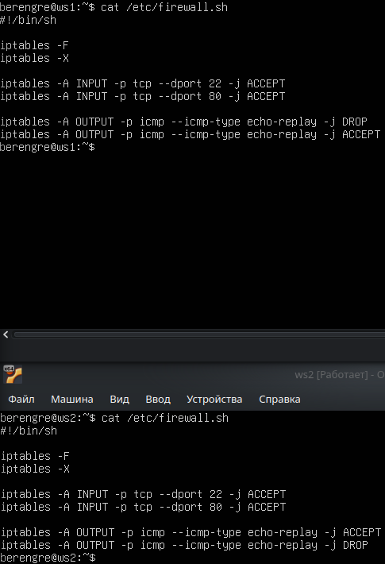

* Отработка команды `ping` друг друга (`ws1 -> ws2` и `ws2 -> ws1`):

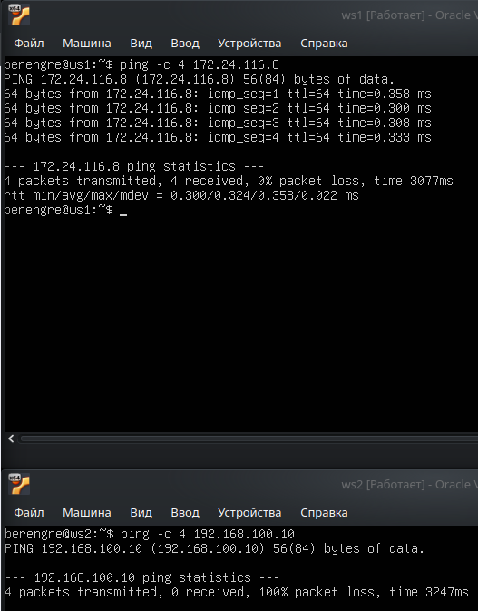

* Разница между их стратегиями заключается в том, что на первой машине мы первой строкой прописываем `DROP`, а команда `ACCEPT` даже не читается на разрешение пинга. То есть до подтверждения при использовании команды `ping` машина **ws1** просто не доходит, тем самым блокируя отклик обратной связи. И абсолютно противоположная ситуация с **ws2**: первой командой идёт `ACCEPT`, а до `DROP` дело не доходит, тем самым машина успешно выкидывает отклик в терминал.

### 4.2 nmap

* Установка `nmap`: `sudo apt update && sudo apt install -y nmap`
* Показываем, что машина **ws1** не пингуется:

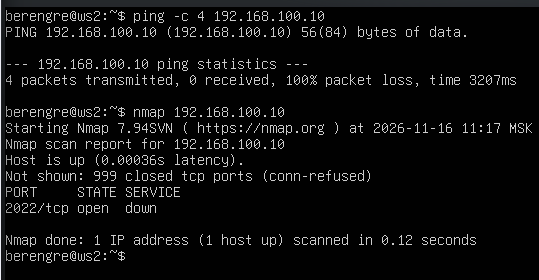

* Прогоняем её через `nmap 192.168.100.10` и видим статус `Host is up`:

---

## Part 5 Статическая маршрутизация сети

### 5.1 Настройка адресов машин

* Поднимаем 5 виртуальных машин: рабочие станции **ws11**, **ws21**, **ws22** и роутеры **r1**, **r2**.
* Настраиваем конфигурации машин в `/etc/netplan/00-installer-config.yaml` согласно схеме сети:

* Конфигурация **ws11** (`10.10.0.2/18`):

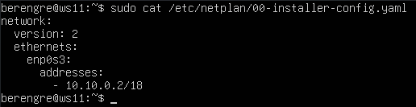

* Конфигурация **r1** (`10.10.0.1/18` и `10.100.0.11/16`):

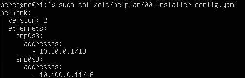

* Конфигурация **r2** (`10.100.0.12/16` и `10.20.0.1/26`):

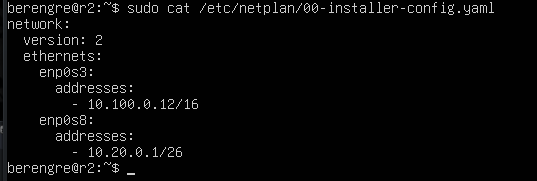

* Конфигурация **ws21** (`10.20.0.10/26`):

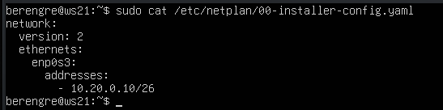

* Конфигурация **ws22** (`10.20.0.20/26`):

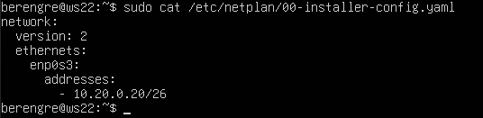

* Перезапускаем сервис сети (`sudo netplan apply`) и проверяем командой `ip -4 a`, что адреса заданы верно:

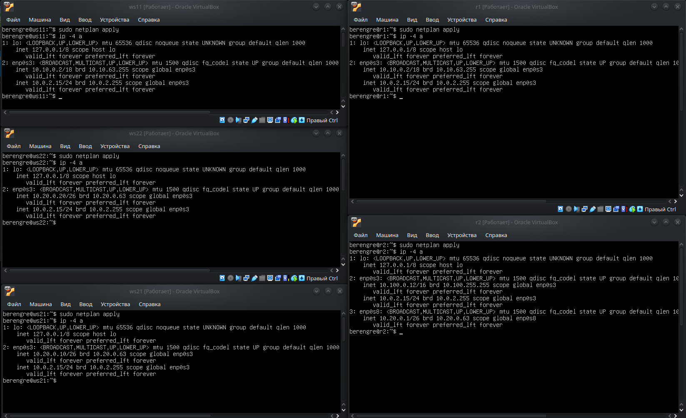

* Пингуем **ws22** с **ws21** и **r1** с **ws11**:

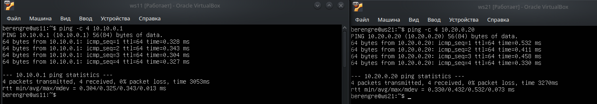

### 5.2 Включение переадресации IP-адресов

* Включаем переадресацию IP-пакетов на роутерах **r1** и **r2** с помощью команды `sudo sysctl -w net.ipv4.ip_forward=1`:

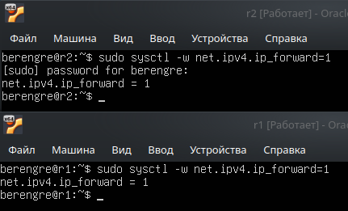

* Добавляем строку `net.ipv4.ip_forward = 1` в файл `/etc/sysctl.conf` на обоих роутерах, чтобы переадресация сохранялась после перезагрузки системы:

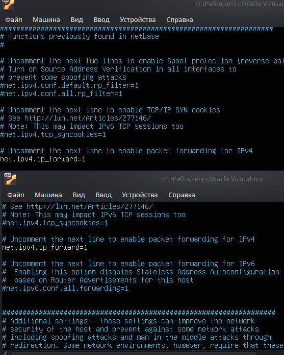

### 5.3 Установка маршрута по умолчанию

* Настраиваем маршрут по умолчанию (`default`) в файле `/etc/netplan/00-installer-config.yaml` для рабочих станций **ws11** (через `10.10.0.1`), **ws21** и **ws22** (через `10.20.0.1`):

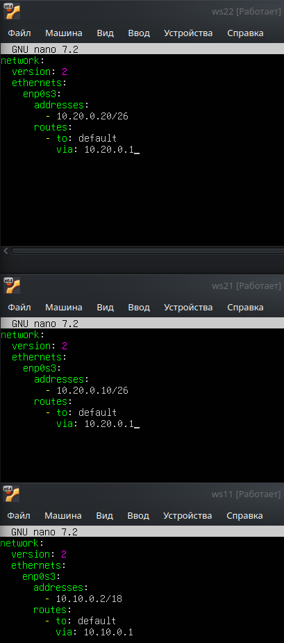

* Вызываем команду `ip r` на рабочих станциях и проверяем наличие маршрута `default via ...`:

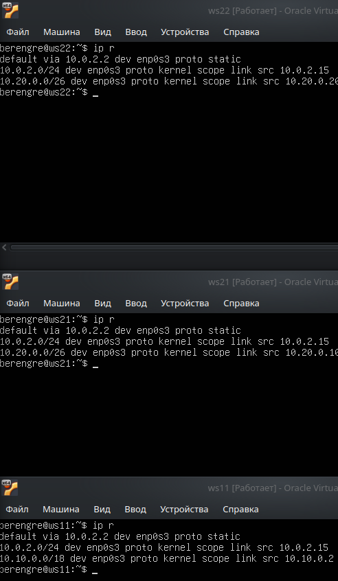

* Пингуем с **ws11** роутер **r2** (`ping -c 4 10.100.0.12`) и фиксируем входящие пакеты на **r2** с помощью `sudo tcpdump -tn -i enp0s3` (ответы обратно не возвращаются, так как на **r2** ещё не прописан обратный маршрут):

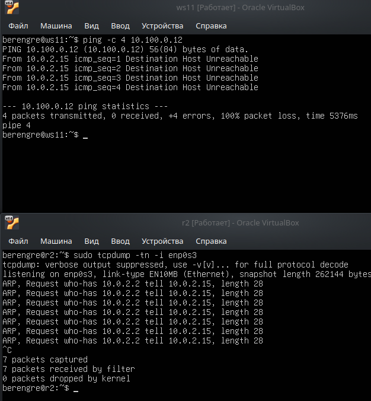

### 5.4 Добавление статических маршрутов

* Добавляем статические маршруты в `/etc/netplan/00-installer-config.yaml` на роутерах **r1** (в сеть `10.20.0.0/26` через `10.100.0.12`) и **r2** (в сеть `10.10.0.0/18` через `10.100.0.11`):

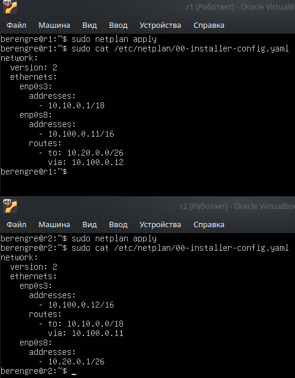

* Проверяем таблицы маршрутизации на обоих роутерах командой `ip r`:

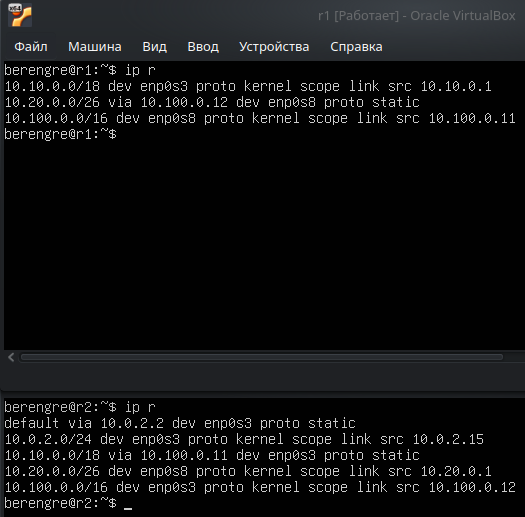

* Запускаем на **ws11** команды `ip r list 10.10.0.0/18` и `ip r list 0.0.0.0/0`:

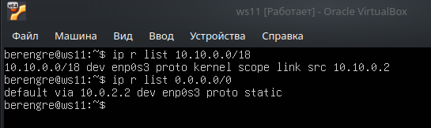

* **Объяснение выбора маршрута:** При выборе маршрута система руководствуется правилом **наиболее точного совпадения (Longest Prefix Match)** — приоритет всегда отдаётся маршруту с самой длинной маской подсети. Маска `/18` более специфична, чем маска маршрута по умолчанию `/0`, поэтому для локальной сети `10.10.0.0/18` система выбирает прямой маршрут через интерфейс `enp0s3`, не отправляя трафик на шлюз по умолчанию.

### 5.5 Построение списка маршрутизаторов

* Запускаем на **r1** перехват трафика `sudo tcpdump -tnv -i enp0s3` и строим маршрут от **ws11** до **ws21** командой `traceroute 10.20.0.10`:

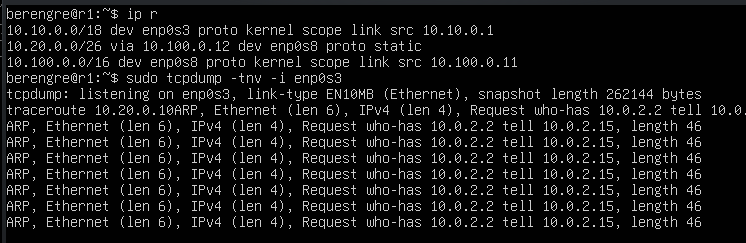

* **Принцип работы `traceroute`:** Утилита отправляет серию пакетов с пошагово увеличивающимся временем жизни пакета (**TTL** — Time To Live), начиная с `TTL=1`. Первый маршрутизатор на пути (**r1**) уменьшает TTL на единицу, получает `0`, отбрасывает пакет и отправляет обратно отправителю ICMP-сообщение `Time Exceeded` (время жизни истекло) — так программа узнаёт адрес первого узла. Следующая серия пакетов отправляется с `TTL=2`, проходит через **r1** и обнуляется на втором маршрутизаторе (**r2**), который также возвращает `Time Exceeded`. Процесс повторяется с увеличением TTL на 1 до тех пор, пока пакеты не достигнут конечного узла (**ws21**).

### 5.6 Использование протокола ICMP при маршрутизации

* Запускаем на **r1** перехват ICMP-трафика `sudo tcpdump -n -i enp0s3 icmp` и пингуем с **ws11** несуществующий IP-адрес `ping -c 1 10.30.0.111`:

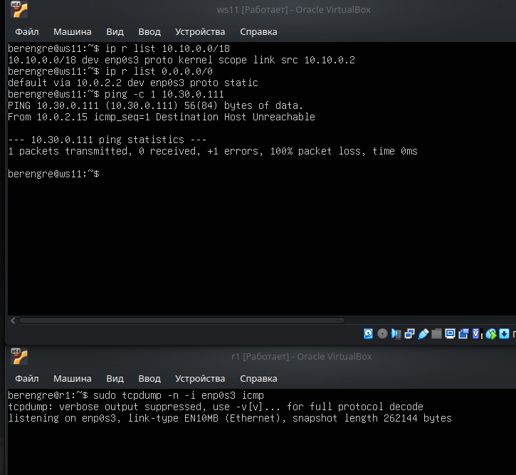

## Part 6 Динамическая настройка IP с помощью DHCP

* Настраиваем службу DHCP на роутере **r2** в файле `/etc/dhcp/dhcpd.conf` (указываем диапазон адресов `10.20.0.2 — 10.20.0.50`, шлюз по умолчанию `10.20.0.1` и DNS-сервер `10.20.0.1`), а также прописываем `nameserver 8.8.8.8` в `/etc/resolv.conf`:

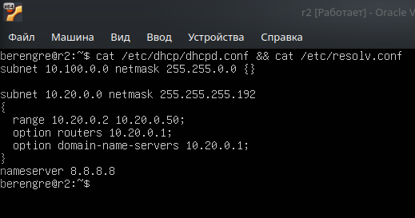

* Перезапускаем службу DHCP (`sudo systemctl restart isc-dhcp-server`), переводим **ws21** на получение адреса по DHCP (`dhcp4: true`), перезагружаем её (`sudo reboot`), проверяем выданный IP-адрес командой `ip a` и пингуем **ws22** (`10.20.0.20`):

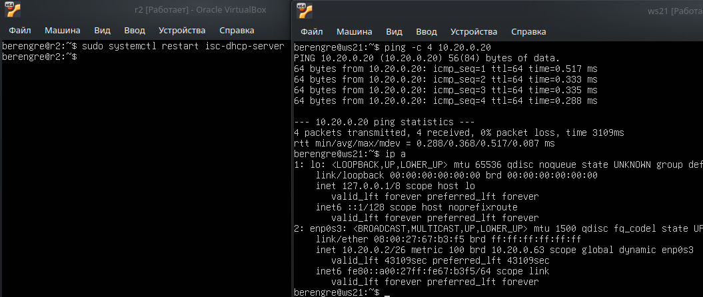

* Указываем статический MAC-адрес `10:10:10:10:10:BA` и включаем `dhcp4: true` в файле `/etc/netplan/00-installer-config.yaml` на **ws11**:

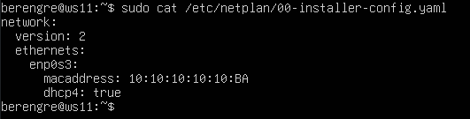

* Настраиваем службу DHCP на роутере **r1** в файле `/etc/dhcp/dhcpd.conf` с жёсткой привязкой IP-адреса `10.10.0.5` к MAC-адресу **ws11** (`hardware ethernet 10:10:10:10:10:BA`), а также добавляем `nameserver 8.8.8.8` в `/etc/resolv.conf`:

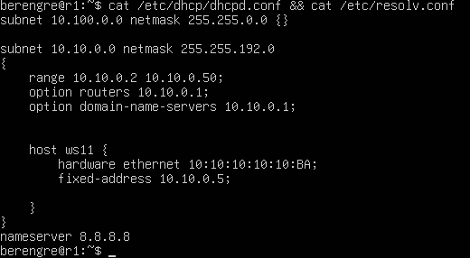

* Перезапускаем DHCP на **r1**, перезагружаем **ws11**, проверяем получение закреплённого IP-адреса `10.10.0.5/18` и пингуем соседа **r1** (`10.10.0.1`):

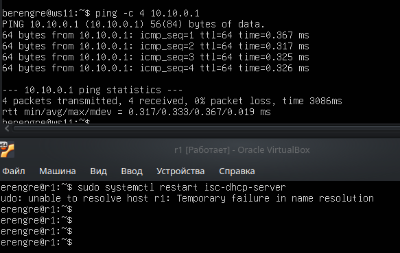

* На **ws21** принудительно запрашиваем обновление аренды IP-адреса у DHCP-сервера с помощью команды `sudo networkctl renew enp0s3` и проверяем вывод `ip -4 a` до и после обновления (видно обновление таймера `valid_lft`):

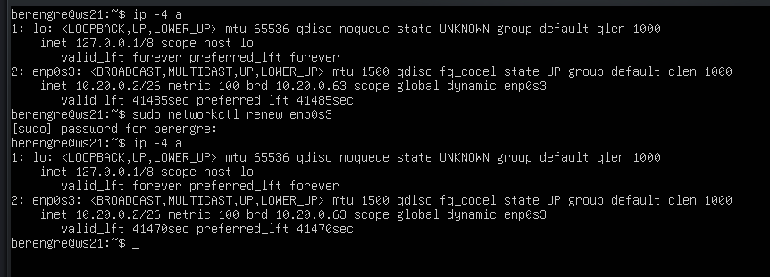

* **Использованные опции DHCP:**
  * При настройке сервера (`dhcpd.conf`) использовались опции **`range`** (задаёт пул свободных IP-адресов для динамической выдачи), **`option routers`** (передаёт клиенту адрес шлюза по умолчанию), **`option domain-name-servers`** (указывает адрес DNS-сервера), а также **`hardware ethernet`** и **`fixed-address`** (для жёсткой резервации конкретного IP за определённым MAC-адресом).
  * На стороне клиента использовалась команда **`networkctl renew`** (инициирует отправку запроса `DHCPREQUEST` для продления/обновления текущей аренды IP-адреса без разрыва сетевого интерфейса).

## Part 7 NAT

* Изменяем строку `Listen 80` на `Listen 0.0.0.0:80` в файле `/etc/apache2/ports.conf` на машинах **ws22** и **r1**, чтобы сделать веб-сервер Apache2 общедоступным:

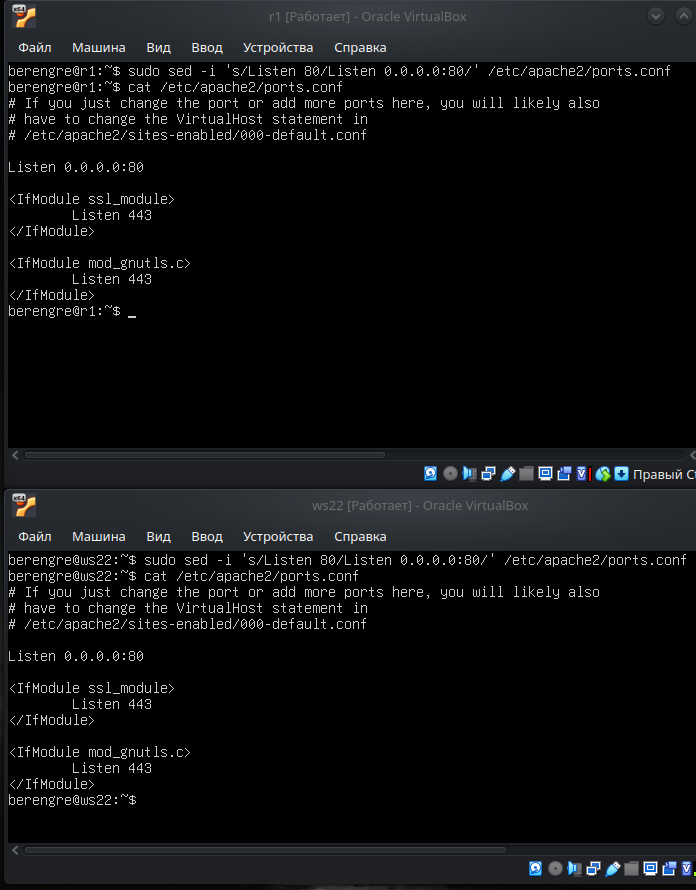

* Запускаем службу веб-сервера Apache2 командой `sudo service apache2 start` на **ws22** и **r1**:

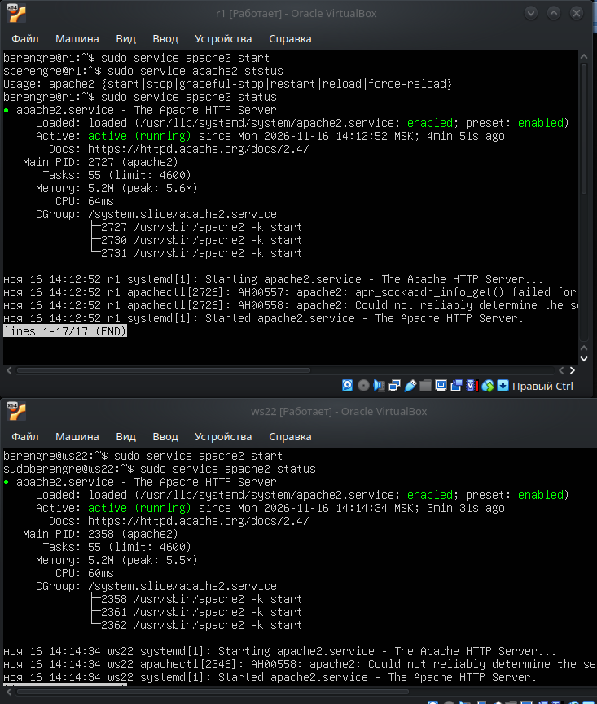

* Создаём скрипт файрвола `/etc/firewall.sh` на роутере **r2** с политикой запрета транзитного трафика (`iptables --policy FORWARD DROP`), запускаем его и проверяем, что **ws22** не пингуется с **r1**:

* Добавляем в `/etc/firewall.sh` на **r2** правило разрешения маршрутизации ICMP-пакетов (`iptables -A FORWARD -p icmp -j ACCEPT`), перезапускаем скрипт и убеждаемся, что **ws22** начинает пинговаться с **r1**:

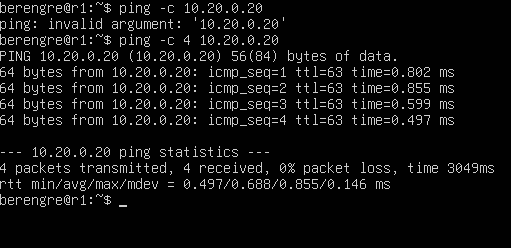

* Дополняем `/etc/firewall.sh` на **r2** правилами для работы **SNAT** (маскирование локальной сети `10.20.0.0/26` за адресом `10.100.0.12`) и **DNAT** (проброс порта `8080` роутера **r2** на порт `80` веб-сервера **ws22**), а также разрешаем прохождение установленных и новых TCP-соединений на порт `80`:

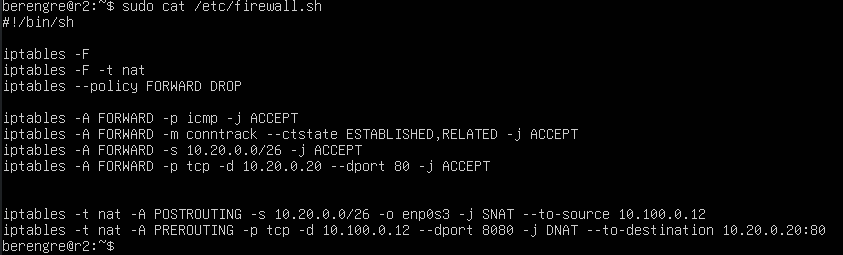

* Запускаем финальный скрипт `/etc/firewall.sh` на **r2** и проверяем работу **SNAT** (`telnet 10.100.0.11 80` с **ws22**) и **DNAT** (`telnet 10.100.0.12 8080` с **r1**):

